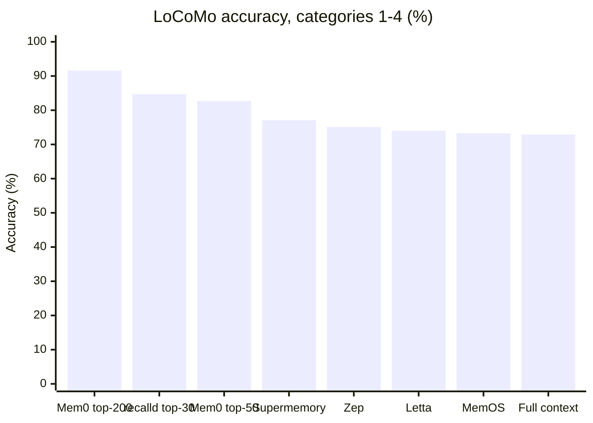

# Benchmark Methodology

## 1. Dataset

**LoCoMo** (Long-term Conversational Memory) is a benchmark for evaluating
long-term conversational memory in LLM agents, introduced by Maharana et al.
at ACL 2024.

> Maharana, A., Lee, D. H., Tulyakov, S., Bansal, M., Barbieri, F., & Fang, Y.
> (2024). Evaluating Very Long-Term Conversational Memory of LLM Agents.
> *Proceedings of the 62nd Annual Meeting of the Association for Computational
> Linguistics (ACL 2024)*, 13851--13870.
> [ACL Anthology](https://aclanthology.org/2024.acl-long.747/) |
> [arXiv:2402.17753](https://arxiv.org/abs/2402.17753)

The full dataset contains 50 conversations and 7,512 QA pairs. The publicly
released evaluation subset contains **10 conversations** and **1,986 questions**
across 5 categories.

### Category breakdown

| # | Category    | Questions | % of total |
|---|-------------|-----------|------------|
| 1 | Multi-hop   | 282       | 14.2%      |
| 2 | Temporal    | 321       | 16.2%      |
| 3 | Open-domain | 96        | 4.8%       |
| 4 | Single-hop  | 841       | 42.3%      |
| 5 | Adversarial | 446       | 22.5%      |
|   | **Total**   | **1,986** |            |
|   | **Non-adversarial (1--4)** | **1,540** | |

> **Note on category numbering.** The LoCoMo paper's prose (Section 4.1)
> lists categories as "single-hop, multi-hop, temporal, open-domain,
> adversarial," but the dataset's numeric IDs follow a different order.
> The mapping above is derived from the LoCoMo evaluation source code
> (`task_eval/evaluation.py`), which uses distinct scoring functions per
> category: category 1 uses sub-answer partial F1 (multi-hop), while
> category 4 uses standard F1 (single-hop). Evidence turn counts confirm
> this (category 1 averages 3.13 evidence turns; category 4 averages
> 1.07). Other projects (e.g., Memobase) have independently identified
> the same discrepancy between the paper's prose order and the code's
> numeric IDs.

Each conversation averages roughly 600 turns across up to 32 sessions.
Conversations were generated via a machine-human pipeline grounded in personas
and temporal event graphs, then verified by human annotators.

### Adversarial questions

Category 5 questions ask about events that never occurred in the conversation.
The correct response is a refusal ("I don't know" or equivalent). These are
**included** in recalld's benchmark results. An optional `--skip-adversarial`
flag exists for comparison purposes.

## 2. Evaluation Pipeline

The benchmark runs a 4-stage pipeline:

```
Ingestion --> Retrieval --> Answer Generation --> Judging
```

Each conversation gets a fresh recalld instance in a temporary directory with
memory decay disabled. This means every benchmark run starts from zero stored
memories -- there is no pre-loaded knowledge.

### 2.1 Ingestion

| Parameter     | Value |
|---------------|-------|
| Model | `claude-sonnet-4-6` (configurable via `--ingest-model`) |
| Temperature   | 0.0 |
| max_tokens    | 2048 |
| Context window | Last 20 conversation turns + last 30 stored memories |

Each conversation turn is processed sequentially. For each turn, the ingestion
LLM receives the recent conversation context and recently stored memories, then
outputs zero or more structured memories to store.

**What is stored per memory:**
- `summary` (required): 1--2 sentence concise summary
- `full_text` (optional): detailed version with context, quotes, and specifics
- `entities` (required): people, places, proper nouns
- `topics` (required): 1--5 topic keywords
- `emotions` (optional): emotional tone
- `supersedes` (optional): ID of a memory this one replaces. The target must
  already exist and live in the same namespace, or `store_memory` rejects the
  store. The harness then retries once without the link, as an agent would,
  so the memory is still stored.

**Storage pipeline per memory:**
1. Generate embedding from concatenation of summary + full_text + tags
2. Insert into storage engine (redb)
3. Add to SIMD vector index
4. Add to FTS5 full-text search index
5. Add as a node in the memory graph
6. If `supersedes` is set, add a Supersedes edge from the new memory to the
   old one. Recall then returns the new memory in place of the old one,
   provided the new one also passes the query's filters
7. Run automatic graph linking (similarity, entity, temporal)

**Graph linking** (three types, all automatic):
- **Similarity**: vector cosine similarity above threshold (default 0.50),
  up to 15 links per memory
- **Entity**: links memories sharing the same named entities, up to 10
  links per memory
- **Temporal**: links memories within a time window (default 1 hour), up to 20
  links per memory

The harness stores every memory by calling the public MCP `store_memory` tool
in process, the same path an agent uses, so the **storage pipeline**
(validation, embedding, indexing, graph linking) is **production's**. A replay
clock is set to each turn's conversation time before the store, so memories
carry the conversation's dates. Memory extraction from conversation turns via
the LLM (`process_turn`) is benchmark-specific -- in production, the calling
LLM client decides what to store.

The harness reacts to tool errors the way an agent would:
- Labels outside `[A-Za-z0-9/_.:-]` (for example topics containing spaces) are
  rejected by the tool; the harness retries once with spaces turned into
  hyphens and other characters dropped.
- A transient, uncommitted `STORAGE_UNAVAILABLE` is retried up to 3 times.
- Any store still rejected is skipped and logged as `store rejected`; the
  conversation continues.

### 2.2 Retrieval

| Parameter       | Value |
|-----------------|-------|
| Model   | Same as answer generation model (configurable via `--model`) |
| Temperature     | 0.0 |
| max_tokens      | 1024 |
| Default top_k   | 15 (configurable via `--top-k`; the published run uses 30) |
| Default graph depth | 2 (LLM can set 0--3 per query) |
| Access recording | Off (searches don't update memory access history) |

Retrieval uses an LLM call to decompose the question into structured search
parameters before searching. The `construct_search_query` method takes the
question text and returns:

- 1--3 semantic search queries (each with optional FTS keyword query)
- Entity, topic, and emotion filters
- Graph traversal depth (0--3, capped at 3)
- Optional time range bounds

If the LLM call fails, the system falls back to a single raw-text query with
depth 1.

**Search execution per query:**
1. SIMD vector similarity search + FTS5 BM25 keyword search, combined via
   `EmbeddingPlusMetadata` query mode
2. Per-query result limit: `top_k/2 + 5` for multi-query, `top_k` for single
   query
3. Results across queries merged by memory ID, keeping the highest score
4. Final results sorted by score descending and truncated to `top_k`

**Post-retrieval graph expansion:**
After the search pipeline returns results, a 1-hop graph traversal collects up
to 10 neighbor memories (sorted by edge weight descending). All 10
neighbors include their full_text. All edge relationships between result memories and
neighbor memories are collected and shown to the answer model.

### 2.3 Answer Generation

| Parameter     | Value |
|---------------|-------|
| Model | `claude-sonnet-4-6` (configurable via `--model`) |
| Temperature   | 0.0 |
| max_tokens    | 4096 |

A **single unified prompt** is used for all question categories. The `category`
parameter is passed as the literal string `"unknown"` and is never used in the
prompt. There is no category routing, per-category prompt selection, or
category-specific examples. The unified prompt includes general reasoning
guidance (e.g., date arithmetic for temporal questions, enumeration for
counting questions) that applies across categories.

The system prompt instructs the model to:
- Base answers only on provided memories
- Reason step by step (identify evidence, chain multi-hop pieces, attend to dates)
- Verify person references before using a memory as evidence
- Use information even when phrasing differs from the question
- Say "I don't know" if insufficient information
- Keep the final answer concise (1--2 sentences after reasoning)

**Context provided to the model:**
- Retrieved memories (up to `top_k`) with: relevance score, creation date,
  summary text, full_text (if present), entity/topic/emotion metadata, and
  graph link annotations
- Graph neighbor memories (up to 10) with: summary, full_text,
  creation date, and edge relationship annotations

The gold answer is **never visible** to the answer model.

### 2.4 Judging

| Parameter     | Value |
|---------------|-------|
| Model | `claude-haiku-4-5` (configurable via `--judge-model`) |
| Temperature   | 0.0 |
| max_tokens    | 1024 |
| Scoring       | Binary: CORRECT or WRONG |

For the Gemini runs, the judge uses the same model family (`gemini-2.5-flash`)
as the answer model but operates as a separate instance with no shared state.
For the Claude runs, the judge uses a different model (`claude-haiku-4-5`) to
avoid self-grading bias.

**Non-adversarial judging** (categories 1--4): The prompt instructs the judge to
be lenient -- synonyms, paraphrases, additional correct details, equivalent date
formats, and same-conclusion answers are all accepted as CORRECT. Prompt examples (espresso/cappuccino, woodworking/carpentry) are drawn
from domains absent from the LoCoMo dataset.

**Adversarial judging** (category 5): Inverted scoring. CORRECT if the model
refuses to answer or says "I don't know." WRONG if it provides any specific
answer as if true. The gold answer field contains the *wrong* answer a tricked
system would give; it is shown to the judge as "Expected wrong answer."

**Mem0-compatible judging** (`BENCH_JUDGE_STYLE`): set `mem0` to judge with
Mem0's 2025 `ACCURACY_PROMPT` (the prompt most published LoCoMo scores use), or
`mem0-v3` for the more lenient judge in Mem0's 2026 memory-benchmarks repo
(which also trims open-domain gold answers at `;`). Unset keeps the prompts
above. The published run uses `mem0`.

**Fallback parsing**: If the judge's JSON output fails to parse, the system
checks whether the cleaned, uppercased response (with markdown code fences
already stripped) contains the quoted string `"CORRECT"` (with surrounding
double quotes) and does not contain the quoted string `"WRONG"`.

## 3. Methodology Notes

### 3.1 Comparison to Other Systems

There is **no standardized LoCoMo evaluation protocol**, so direct numeric
comparisons across memory systems are unreliable. Each system uses different:

- Ingestion models and prompts
- Answer generation models and prompts
- Judge models and prompts
- Retrieval configurations and architectures
- Scoring criteria and leniency thresholds

The Mem0/Zep dispute (documented in
[zep-papers#5](https://github.com/getzep/zep-papers/issues/5)) demonstrated that
methodology differences can swing reported scores by over 25 percentage points
on the same dataset. Zep's initially reported 84% was evaluated at 58.44% by
Mem0 after fixing category inclusion errors and prompt normalization; Zep
disputed this figure and claimed a corrected score of 75.14%.

**Model configuration:**

| Component   | recalld (CLI default)     | Mem0 (published, April 2026) |
|-------------|----------------------|------|
| Ingestion   | `claude-sonnet-4-6` (Gemini runs use `gemini-2.5-flash`) | Not disclosed for published score; open-source default is `gpt-4o-mini` |
| Answer gen  | `claude-sonnet-4-6` (Gemini runs use `gemini-2.5-flash`) | Not disclosed; open-source default is `gpt-4o` |
| Judge       | `claude-haiku-4-5` (Gemini runs use `gemini-2.5-flash`) | Not disclosed; open-source default is `gpt-4o` |
| Embeddings  | `embeddinggemma:300m` (768d, via Ollama) | `text-embedding-3-small` (1536d) |

Mem0's published 92.5% score does not disclose which exact models were
used for that specific result. Their evaluation framework is open-sourced
at [github.com/mem0ai/memory-benchmarks](https://github.com/mem0ai/memory-benchmarks),
with defaults of `gpt-4o` for answer generation and judging, and
`gpt-4o-mini` for extraction.

### 3.2 Prompt Design

All prompts (ingestion, answer generation, search query construction,
judging) use generic examples and instructions drawn from domains absent
from the LoCoMo dataset (verified by searching `locomo10.json`). No
LoCoMo-specific questions, answers, or dataset knowledge is embedded in
any prompt.

The answer generation prompt describes "long personal conversations between two
people who are friends" -- this matches the LoCoMo format but is not
LoCoMo-specific; it describes the domain recalld operates in.

The **original LoCoMo paper** used category-specific prompts for evaluation.
recalld deliberately uses a single unified prompt, following the emerging
industry practice advocated by LoCoMo-Plus ([arXiv:2602.10715](https://arxiv.org/abs/2602.10715)), which uses a
single input prompt with category-specific judging.

### 3.3 LLM-Augmented Retrieval

recalld uses an additional LLM call per question to decompose it into structured
search parameters (multiple semantic queries, FTS queries, entity/topic filters,
graph depth, time range).

recalld is an MCP tool for AI agents. In production, the calling agent (e.g.,
Claude Code) already reasons about what to search for before invoking
`recall_memories` -- it decides the query text, entity filters, graph depth, and
time range. The `construct_search_query()` call in the benchmark simulates this
agent-side reasoning. In the benchmark this appears as a separate LLM call; in
production it is part of the agent's existing turn, not an additional API call.
The MCP tool schema exposes these parameters precisely because they are meant to
be driven by an LLM. Removing this step would benchmark a usage pattern that
does not reflect how the tool is actually used.

### 3.4 Statistical Considerations

**Confidence intervals.** Wilson 95% confidence intervals should be reported
alongside point estimates. For reference, at n = 1,986 (all questions):

| Observed accuracy | 95% CI (Wilson) |
|-------------------|-----------------|
| 80%               | [78.2%, 81.7%]  |
| 85%               | [83.4%, 86.5%]  |
| 90%               | [88.6%, 91.2%]  |
| 92.5%             | [91.3%, 93.6%]  |

**Clustering.** The 1,986 questions are clustered within 10 conversations.
Questions within a conversation share ingested context. The effective sample
size for between-conversation variation is 10, not 1,986.

**LLM judge noise.** Binary decisions from LLM judges have approximately
10--20% disagreement with human annotators. The LoCoMo-Plus paper reports
human-LLM judge agreement of 0.80--0.82, compared to 0.90 inter-annotator
agreement. Mem0's documentation states "+/- 1 point confidence interval due to
judge inconsistency." Different judge prompts have been observed to produce
~10% scoring differences on the same answers
([ByteRover](https://www.byterover.dev/blog/benchmark-ai-agent-memory)).

**Determinism.** All LLM calls use temperature 0.0. Results are deterministic
within a model version but not across model updates. LLM outputs at temperature
0 can still vary slightly across API calls due to batching and quantization.

### 3.5 Known Limitations

**Ground truth errors.** An independent audit by Penfield Labs identified 99
score-corrupting errors across the 1,540 non-adversarial questions (6.4% error
rate), including hallucinated facts in the answer key, incorrect temporal
reasoning, and speaker attribution errors. The audit did not cover the 446
adversarial questions (category 5). Assuming adversarial ground truth is
reliable (the expected answer is simply a refusal), the 99 errors across the
full 1,986 questions yield a **5.0% error rate** and a **practical accuracy
ceiling around 95%**. For reference, Northcutt et al. (NeurIPS 2021) found an
average 3.3% label error rate across 10 major ML benchmarks.

> Penfield Labs. "We Audited LoCoMo: 6.4% of the Answer Key Is Wrong, and the
> Judge Accepts Up to 63% of Intentionally Wrong Answers."
> [penfieldlabs.substack.com](https://penfieldlabs.substack.com/p/we-audited-locomo-64-of-the-answer)

**LLM judge vulnerability.** When tested with `gpt-4o-mini` as judge against
intentionally wrong but topically related answers, 62.81% of wrong answers were
accepted overall. Specific factual errors (wrong names/dates) were caught ~89%
of the time, but vague, topically adjacent answers missing specific details
passed ~63% of the time (Penfield Labs, ibid.).

**Ingestion context limits.** The ingestion window is limited to the last 20
conversation turns and last 30 stored memories. For very long conversations,
early context may be unavailable to the ingestion model when processing later
turns.

**max_tokens truncation.** LLM calls use `max_tokens` of 1024--4096
depending on call type (1024 for search query construction and judging,
2048 for ingestion, 4096 for answer generation). Complex multi-hop
reasoning chains may still be truncated at the lower limits.

**Model version dependency.** Results depend on specific model versions
(`gemini-2.5-flash`, `claude-sonnet-4-6`) which are not version-pinned beyond
their model identifiers. Model updates from providers may change results.

**Single-hop dominance.** 841 of 1,986 questions (42.3%) are single-hop,
making this the largest category. Single-hop questions require retrieving
a single fact from one session, so retrieval quality is the primary
bottleneck.

**Conversation diversity.** 10 conversations may not generalize to all
conversational domains, relationship types, or cultural contexts.

**Embedding dilution.** Embeddings are generated from the concatenation of
summary + full_text + tags. Long full_text fields may dilute the semantic signal
from the summary.

## 4. Reproducibility

### Requirements

- Rust toolchain (see `rust-toolchain.toml`)
- One of the following LLM backends (checked in priority order):
  - **OpenAI-compatible**: `--llm-url http://host:port`. Set
    `BENCH_LLM_API_KEY` to send it as a bearer token (for keyed servers or
    proxies, e.g. LiteLLM in front of Amazon Bedrock).
  - **Gemini on Vertex AI**: `GEMINI_VERTEX_PROJECT_ID` + gcloud auth.
    Optional: `GEMINI_VERTEX_REGION` (default: `us-central1`).
    Requires `--model gemini-*` / `--ingest-model gemini-*` / `--judge-model gemini-*`
  - **Claude on Vertex AI**: `CLAUDE_CODE_USE_VERTEX=1` + `CLOUD_ML_REGION` +
    `ANTHROPIC_VERTEX_PROJECT_ID`
  - **Anthropic API**: `ANTHROPIC_API_KEY`

### Command

```bash
cargo run --features bench --release -- bench locomo
```

### Configurable parameters

| Flag                | Default                       | Description |
|---------------------|-------------------------------|-------------|
| `--data`            | `src/bench/data/locomo10.json`| Path to dataset file |
| `--top-k`           | `15`                          | Retrieved memories per question |
| `--model`           | `claude-sonnet-4-6`           | Answer generation and query construction model |
| `--ingest-model`    | `claude-sonnet-4-6`           | Conversation ingestion model |
| `--judge-model`     | `claude-haiku-4-5`            | Answer judging model |
| `--llm-url`         | *(none)*                      | OpenAI-compatible LLM server URL |
| `--parallel`        | `2`                           | Number of conversations to evaluate concurrently |
| `--qa-parallel`     | `4`                           | Number of QA pairs to evaluate concurrently per conversation |
| `--skip-adversarial`| `false`                       | Exclude category 5 questions |
| `--diagnose`        | `false`                       | Run retrieval diagnostics only (no LLM calls for QA) |
| `--format`          | `human`                       | Output format (`human` or `json`) |

### Data integrity

- Gold answers are never visible to the ingestion, retrieval, or answer
  generation stages
- The gold answer is only visible to the judge model
- The answer model and judge model are separate instances with different models
  by default
- Prompt examples are drawn from domains verified absent from the dataset
- Each conversation gets a fresh, empty recalld instance

## 5. Results

Results are stored in `benchmarks/<run-name>/bench_results.json` (per-question
answers, judgments and timings).

### Run: Qwen3 235B, embeddinggemma, top-k 30 (all categories)

**Configuration:**
- recalld: v2.x native storage; memories written through the real
  `store_memory` MCP tool
- Model (ingestion + answer gen): Qwen3 235B A22B 2507 (Amazon Bedrock)
- Judge: DeepSeek V3.2 (Amazon Bedrock) with Mem0's 2025 `ACCURACY_PROMPT`
  (`BENCH_JUDGE_STYLE=mem0`)
- Embeddings: `embeddinggemma:300m` (768d, via Ollama)
- Top-k: 30
- Categories: all 5 (including adversarial)
- Results: `benchmarks/qwen3-235b-embeddinggemma-top30/`

**Overall accuracy: 83.9%** (1,667/1,986), Wilson 95% CI [82.3%, 85.5%]

**Excluding adversarial: 84.7%** (1,305/1,540), Wilson 95% CI [82.9%, 86.4%]

| Category    | Correct | Total | Accuracy |
|-------------|---------|-------|----------|
| Single-hop  | 738     | 841   | 87.8%    |
| Multi-hop   | 244     | 282   | 86.5%    |
| Temporal    | 257     | 321   | 80.1%    |
| Open-domain | 66      | 96    | 68.8%    |
| Adversarial | 362     | 446   | 81.2%    |
| **Overall (1--5)** | **1,667** | **1,986** | **83.9%** |

2,438 memories were stored across the 10 conversations. Mean latency per
question: retrieval 5.7 s (dominated by the LLM query-construction call),
answer 3.9 s, judge 3.1 s.

**Context size.** The answer model saw on average 9,820 tokens of memory
context per question (median 9,752, p95 11,611; `o200k_base` tokenizer):
30 retrieved memories plus about 10 graph neighbors, about 245 tokens each.

## 7. Comparison

Due to the methodological differences described in Section 3.1, these numbers
are **not directly comparable**: systems used different answer models, judges,
judge prompts and amounts of retrieved context. Scores below exclude
adversarial questions (categories 1--4), which is how most vendors report.



| System | Accuracy (cat. 1--4) | Retrieved context | Answer model | Judge |
|--------|----------------------|-------------------|--------------|-------|
| Mem0 (memory-benchmarks, 2026) | 91.6% | top 200 | GPT-5 | Mem0 v3 judge (more lenient) |
| **recalld** | **84.7%** | top 30 | Qwen3 235B | Mem0 2025 judge, DeepSeek V3.2 |
| Mem0 (memory-benchmarks, 2026) | 82.7% | top 50 | GPT-5 | Mem0 v3 judge (more lenient) |
| Supermemory | 77.1% | -- | -- | Not published; stated in a GitHub issue |
| Zep (2025, corrected) | 75.1% | -- | gpt-4o-mini | Mem0 2025 judge |
| Letta | 74.0% | raw transcripts | gpt-4o-mini | Strict judge |
| MemOS | 73.3% | top 20 | gpt-4o-mini | Mem0 2025 judge |
| Full conversation in context (Mem0 paper) | 72.9% | everything | gpt-4o-mini | Mem0 2025 judge |
| Human (original paper) | 87.9% F1 | -- | -- | Token-level F1, different metric |
| Accuracy ceiling | ~95% | -- | -- | Limited by ground-truth errors (Penfield Labs) |

Mem0's README headline of 92.5% and Zep's later 94.7% claim are omitted: no
public configuration reproduces them.
